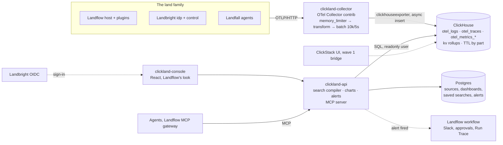

# Clickland: the plan (proposed)

Status: **proposed, 14 November 2026.** Not approved; nothing below is built. The evidence is in
[research.md](research.md).

## What Clickland is

The land family's own observability system: every Landflow run, plugin call and AI call, every Landbright sign-in,
every Landfall agent turn, searchable as logs, traces and metrics. It has alerts and dashboards, and it answers agents
over MCP. It replaces the development-only `landflow-lgtm` pod (Grafana LGTM in an `emptyDir`, which loses everything
on restart: Landflow `docs/specs/08-durable-telemetry.md`).

## The decision the study leads to

Reverse-engineering ClickHouse shows that its value is a storage and execution engine refined over a decade: part
formats, codecs, sparse indexes, the new `text` index, vectorized aggregation, merges and Keeper. ClickStack, ClickHouse's
own observability product, does not reimplement any of it. Its work is the **schema, the search-to-SQL compiler, pattern
mining and alerts**, roughly 20k lines of TypeScript in `common-utils` (research §3).

So Clickland **runs ClickHouse (Apache-2.0) unchanged** and builds the observability layer itself. Three ways to do
that:

| Option | What | For | Against |
|---|---|---|---|
| A. Adopt ClickStack | Run ClickStack (MIT) as it is; wire Landbright OIDC and Landflow's OTLP to it | Working in a day; follows upstream | MongoDB; its look, not Landflow's; no land-family identity or Landflow workflows; we don't own the code |
| **B. Build on a ClickStack-compatible schema** (recommended) | Our own collector config, schema, compiler, API and UI in the land-family stack (TypeScript, Postgres, `@land/tokens`, Landbright sign-in), keeping ClickStack's `otel_*` tables | Owns the product; reuses Landflow (alerts as workflows, MCP gateway) and Landbright (identity); ClickStack can still read the same tables while ours is built | More to build |
| C. Reimplement a column store | Write a storage engine | Learning | Years of work to reach what ClickHouse already is; nothing in the goal needs it |

**Recommendation: B, with A as the bridge.** Wave 1 runs ClickHouse with the ClickStack schema, so the stock
ClickStack UI works on our data from the first day while Clickland's own UI and compiler are built over the same tables.

## Architecture (option B)

## Waves

| Wave | Builds | Done when |
|---|---|---|
| 0. Foundations | Repo layout (pnpm + Nx like Landbright), constitution, `deploy/` compose for ClickHouse + collector, `specs/` templates | `pnpm verify` green; ClickHouse and the collector run as `clickland-dev` compose project |
| 1. Store and ingest | ClickHouse single node with the ClickStack schema (versioned migrations), the collector with batching and a memory limit, Landflow and Landbright pointed at it, retention by TTL, the stock ClickStack UI as a bridge | A Landflow run's trace and logs show in ClickStack; a restart keeps them; parts stay under the back-pressure limits at a soak load |
| 2. Search | The search compiler (Lucene-style → SQL that uses `hasAllTokens`, materialized columns and rollups; checked with `EXPLAIN indexes=1` in tests), the API, the console's search and trace views in Landflow's look, Landbright sign-in | A search for an error string reads only the granules the text index allows; a trace opens from Landflow's Run Trace via `LANDFLOW_TRACE_URL` |
| 3. Charts, alerts, MCP | Chart compiler with rollup substitution, dashboards, alerts as periodic SQL that start a Landflow workflow, the MCP server behind Landflow's gateway | An alert on Landflow plugin errors posts to Slack through a Landflow flow; an agent answers "why did run X fail" over MCP |
| 4. Analysis | Drain patterns, event deltas, service map from spans, SLOs | Patterns group a day of Landflow logs into templates; an SLO burn alert fires in a soak |
| 5. Cluster (only if needed) | ReplicatedMergeTree + Keeper on the `clickland-dev` namespace, object storage tier on the local MinIO, backups | A replica can be killed without losing writes |

## Questions for you

1. Option A, B or C (B recommended).
2. Should Clickland replace `landflow-lgtm` in the Landflow cluster overlay once wave 1 works, or run beside it?
3. Retention: the default proposal is 30 days of logs and traces, 90 days of metrics.
