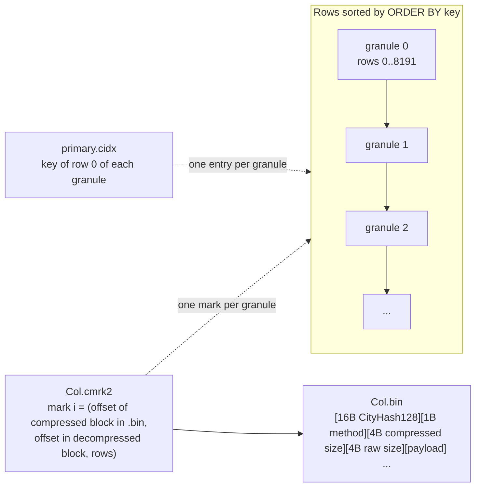

# ClickHouse storage engine: how it works, and what Clickland should take

Source: `upstream/clickhouse` at commit `1b7851acb7ca` (2026-11-14). All paths are relative to that folder.
Line numbers are for that commit. Claims come from `src/` unless marked **[docs]**. Settings defaults are
quoted from the `DECLARE(...)` lines in `src/Storages/MergeTree/MergeTreeSettings.cpp` (table-level, "MT")
and `src/Core/Settings.cpp` (query/session-level, "query"), and `src/Core/ServerSettings.cpp` ("server").

Scope: storage only. The query pipeline, server, cluster, replication protocol and wire formats are covered
elsewhere.

## Summary

A MergeTree table is a set of immutable **parts**. Each INSERT block is split by partition, sorted by the
`ORDER BY` key, and written as a new part directory. A part stores each column (or, for small parts, all
columns together) as a sequence of **compressed blocks**; rows are grouped into **granules** (at most 8192
rows or about 10 MiB uncompressed), and for each granule a **mark** records where that granule starts: the
byte offset of its compressed block in the `.bin` file and the offset inside the decompressed block. The
**primary index** is sparse: one key tuple per granule, held in memory. A query turns its `WHERE` into a
`KeyCondition`, prunes whole parts with the partition min/max index, then binary-searches or
exclusion-searches the primary index to find candidate granule ranges, then asks each **skip index**
(minmax, set, bloom filters, the inverted text index) to drop more granules, and only then reads and
decompresses the remaining granules. Background **merges** combine small parts into bigger ones (never
across partitions), and that is also where TTL, deduplication (Replacing), pre-aggregation
(Summing/Aggregating) and collapsing happen. Back-pressure is simple: too many active parts in one
partition first delays, then rejects INSERTs. Storage policies place parts on volumes (local SSD, then S3)
and move them by TTL or free space; object-storage disks keep part file names locally (or in a "plain"
layout) and data in randomly named blobs, with a local filesystem cache in front.

The main design levers for an observability store are: a low-cardinality-first sort key ending in time,
daily (or coarser) partitions with `ttl_only_drop_parts`, specialised codecs on timestamps and metrics,
`LowCardinality` for service and level names, the text index for log bodies, and batching inserts (async
inserts are now on by default) so that parts stay large.

## A part on disk

A Wide part of a log table, with the defaults at this commit (`compress_marks = true`, so marks are
`.cmrk2`; `compress_primary_key = true`, so the index is `primary.cidx`):

```text
<table data path>/
  20261114_1_57_3/                  <partition_id>_<min_block>_<max_block>_<level>[_<mutation>]
    checksums.txt                   size + CityHash128 of every file ("checksums format version: 4")
    columns.txt                     column names and types
    columns_substreams.txt          stream list per column (dynamic types: JSON, Dynamic, Map buckets)
    count.txt                       row count
    serialization.json              per column: DEFAULT or SPARSE kind, type serialization versions
    default_compression_codec.txt   codec chosen for the part (LZ4 or ZSTD(3), see section 2)
    metadata_version.txt
    partition.dat                   the partition key value
    minmax_Timestamp.idx            min/max of each partition-key column in this part
    ttl.txt                         min/max TTL per rule (drives TTL merges and moves)
    primary.cidx                    sparse primary index: one key tuple per granule (+ final mark)
    Timestamp.bin   Timestamp.cmrk2           column data + one mark per granule
    ServiceName.dict.bin  ServiceName.bin  ServiceName.cmrk2   LowCardinality: dictionary + indexes
    Body.bin  Body.size.bin  (+ .cmrk2 each)  String with separate length stream (default since 25.11)
    LogAttributes.size0.bin  LogAttributes.keys.bin  LogAttributes.values.bin   Map = Array(Tuple)
    TraceId.null.bin ...            Nullable null map, if Nullable
    skp_idx.packed                  small skip-index streams bundled in one file (<= 1 MiB each)
    skp_idx_<name>.idx2 / .cmrk2    a larger skip index, standalone
    skp_idx_<text>.idx .dct .pst [.pos]  text index: granule, dictionary, postings, positions
    <projection>.proj/              a projection is a nested part with the same layout
```



A Compact part (small parts, below `min_bytes_for_wide_part`) has the same metadata files, but all columns
live in one `data.bin`, granule after granule, with one `data.cmrk4` mark file holding, per granule, one mark
per column substream plus the row count.

### One log row, from INSERT to disk and back

1. The client sends `INSERT`. With `async_insert = 1` (default) the server buffers the data per
   (table, format, settings) key and flushes it as one block after 50 to 200 ms or 10 MiB
   (`src/Interpreters/AsynchronousInsertQueue.cpp:709`, `:868`, `:931`).
2. `MergeTreeSink::consume` checks back-pressure (`MergeTreeData::delayInsertOrThrowIfNeeded`) and splits
   the block by partition key (`MergeTreeDataWriter::splitBlockIntoParts`,
   `src/Storages/MergeTree/MergeTreeSink.cpp:142`, `:151`).
3. `MergeTreeDataWriter::writeTempPartImpl` computes the partition min/max, sorts the block by the sorting
   key with a stable permutation, picks Wide or Compact format and the codec, and writes a
   `tmp_insert_<name>` directory (`src/Storages/MergeTree/MergeTreeDataWriter.cpp:817`, `:870`, `:927`,
   `:1059`, `:1149`).
4. The writer cuts the rows into granules (rows per granule = min(8192, 10 MiB / average row size)), and for
   each granule and each column stream writes a mark, then serialises the granule's values into the stream's
   compression buffer. When that buffer holds at least `min_compress_block_size` (64 KiB) at a mark, it is
   compressed and flushed, so granules usually start at a block boundary
   (`src/Storages/MergeTree/MergeTreeDataPartWriterWide.cpp:519`). Each block gets a 16-byte checksum and a
   9-byte header (`src/Compression/CompressedWriteBuffer.cpp:30`).
5. The first row of each granule goes into `primary.cidx`; skip-index aggregators summarise each group of
   `GRANULARITY` granules (`src/Storages/MergeTree/MergeTreeDataPartWriterOnDisk.cpp:277`, `:313`).
6. `MergeTreeSink::commitPart` renames the temporary part into place, assigns a block number, and triggers
   the merge scheduler (`MergeTreeSink.cpp:455`, `:509`, `:357`).
7. On `SELECT ... WHERE ServiceName = 'api' AND Timestamp > now() - 3600 AND hasToken(Body, 'timeout')`: the
   partition min/max prunes old partitions; `KeyCondition` over `primary.cidx` keeps only granule ranges whose
   key range can match; the text index keeps only granules with rows containing `timeout`; then for each
   surviving granule the reader seeks to its mark (`MergeTreeReaderStream::seekToMark`,
   `src/Storages/MergeTree/MergeTreeReaderStream.cpp:223`), decompresses the block and filters rows.

---

## 1. MergeTree on disk: parts, granules, marks, primary index

### How it works

- **Part names.** `MergeTreePartInfo::getPartNameV1` writes `partition_id_minblock_maxblock_level` and
  `_mutation` if any. An insert gets one new block number (`min = max`); a merge spans the source range and
  raises the level.
- **Wide vs Compact.** `MergeTreeData::choosePartFormat` picks Compact when the uncompressed size is below
  `min_bytes_for_wide_part` or rows below `min_rows_for_wide_part` (or level below `min_level_for_wide_part`),
  otherwise Wide. Wide = one `.bin` + one mark file per column stream. Compact = all columns in `data.bin`,
  columns serialised one after another inside each granule.
- **Packed storage.** A newer "Packed" storage type puts all files of a part into one archive (`data.packed`).
  It is used only when size is below `min_bytes_for_full_part_storage`, which defaults to 0, so it is off by
  default. Small skip-index streams are packed into `skp_idx.packed` by default (`packed_skip_index_max_bytes`).
- **Granules and adaptive granularity.** `computeIndexGranularity` takes the block's uncompressed size: if the
  block is bigger than `index_granularity_bytes`, rows per granule = rows / (bytes / 10 MiB); otherwise rows
  per granule = 10 MiB / average row size; then it is capped at `index_granularity` (8192). Each granule's row
  count is kept in memory (8 bytes each) unless `use_const_adaptive_granularity` makes it one value per part.
- **Marks.** A mark is `(offset_in_compressed_file, offset_in_decompressed_block)`, plus the granule's row
  count when granularity is adaptive. Extensions encode the variant: `.mrk` (fixed granularity, Wide),
  `.mrk2` (adaptive, Wide), `.mrk3` (Compact), `.mrk4` (Compact with per-substream marks); a leading `c`
  (`.cmrk2`, `.cmrk4`) means the mark file itself is compressed (ZSTD(3) by default).
- **How a mark lands on a block boundary.** Before writing a mark, the writer flushes the stream's
  compression buffer if it already holds `min_compress_block_size` bytes. After a granule, if the buffer is
  exactly full it is flushed too. So a block holds one or more whole granules (small columns) or a granule
  spans several blocks (wide strings, up to `max_compress_block_size` = 1 MiB each); a mark can point into
  the middle of a block when the previous block was still small.
- **Primary index.** For each granule that starts in the block (`granule.mark_on_start`), the writer
  serialises the primary-key columns of that first row. Adaptive Wide parts also write a final mark with the
  last row. The index is loaded lazily into memory (`primary_key_lazy_load = true`) or into a shared cache
  (`use_primary_key_cache`). `PRIMARY KEY` may be a prefix of `ORDER BY`; only the prefix goes into the index.
- **Checksums.** `checksums.txt` stores, per file, size and CityHash128, and for compressed files also the
  uncompressed size and hash. Writes go to `tmp_insert_*`, `tmp_merge_*`, `tmp_mut_*` and are renamed when
  complete. Replaced parts are kept for `old_parts_lifetime` (480 s) before removal.

### Key code

- Part types: `src/Storages/MergeTree/MergeTreeDataPartType.h:13` (Wide/Compact), `:42` (Full/Packed storage).
- Format choice: `src/Storages/MergeTree/MergeTreeData.cpp:7591` (`choosePartFormat`).
- Metadata file list: `src/Storages/MergeTree/IMergeTreeDataPart.h:830` (`COMMON_METADATA_FILES`), `:699`
  (`serialization.json`), `:1064` (`.idx` vs `.cidx`).
- Part name: `src/Storages/MergeTree/MergeTreePartInfo.cpp:223`.
- Mark extensions: `src/Storages/MergeTree/MergeTreeIndexGranularityInfo.h:17`, `.cpp:27`, `.cpp:82`.
- Mark struct: `src/Formats/MarkInCompressedFile.h:17`.
- Granule size: `src/Storages/MergeTree/MergeTreeIndexGranularity.cpp:120` (`computeIndexGranularity`).
- Wide writer: `src/Storages/MergeTree/MergeTreeDataPartWriterWide.cpp:392` (`write`), `:504`
  (`flushMarkToFile`), `:519` (mark offsets, flush at `min_compress_block_size`), `:561` (`writeSingleGranule`).
- Compact writer: `src/Storages/MergeTree/MergeTreeDataPartCompact.h:13` (format comment),
  `src/Storages/MergeTree/MergeTreeDataPartWriterCompact.cpp:309` (`writeDataBlock`).
- Primary index write: `src/Storages/MergeTree/MergeTreeDataPartWriterOnDisk.cpp:131`, `:262`, `:277`.
- Primary index load/cache: `src/Storages/MergeTree/IMergeTreeDataPart.cpp:696`, `:716`.
- Packed part storage: `src/Storages/MergeTree/DataPartStorageOnDiskPacked.h:12`.
- Checksums: `src/Storages/MergeTree/MergeTreeDataPartChecksum.h:19`, `.cpp:249`.
- Mark loading (MarkCache): `src/Storages/MergeTree/MergeTreeMarksLoader.cpp:119`; seek:
  `src/Storages/MergeTree/MergeTreeReaderStream.cpp:223`.

### Settings

- `index_granularity` MT = 8192 rows.
- `index_granularity_bytes` MT = 10 MiB; `min_index_granularity_bytes` MT = 1024.
- `use_const_adaptive_granularity` MT = false.
- `min_bytes_for_wide_part` MT = 10 MiB (1 GiB in one build variant, `MergeTreeSettings.cpp:31-33`);
  `min_rows_for_wide_part` MT = 0; `min_level_for_wide_part` MT = 0.
- `min_bytes_for_full_part_storage` MT = 0 (Packed off).
- `compress_marks` MT = true; `marks_compression_codec` MT = `ZSTD(3)`.
- `compress_primary_key` MT = true; `primary_key_compression_codec` MT = `ZSTD(3)`.
- `primary_key_lazy_load` MT = true; `use_primary_key_cache` MT = false.
- `write_marks_for_substreams_in_compact_parts` MT = true.
- `old_parts_lifetime` MT = 480 s.
- Server: `mark_cache_size`, `primary_index_cache_size`, `uncompressed_cache_size`
  (`src/Core/ServerSettings.cpp:653-684`).

### What Clickland should take from this

- Keep the defaults (8192 rows / 10 MiB). Log rows are usually 0.3 to 2 KiB, so the 8192-row cap binds and
  each granule is a few MiB; the in-memory index is one key tuple per 8192 rows, which is cheap.
- Put few, short columns in the primary key: the key tuple is held in RAM for every granule of every part.

## 2. Compression: block format, codecs, chains

### How it works

- **Block format.** Each column stream is a sequence of independent blocks:
  `[CityHash128 of the rest: 16 B][method byte: 1 B][compressed size incl. header: 4 B LE][uncompressed size: 4 B LE][payload]`.
  The checksum is computed over the header and payload and checked on read.
- **Method bytes.** NONE 0x02, LZ4 0x82, ZSTD 0x90, Multiple 0x91, Delta 0x92, T64 0x93, DoubleDelta 0x94,
  Gorilla 0x95, AES-128/256-GCM-SIV 0x96/0x97, FPC 0x98, GCD 0x9a, plus newer ALP 0x9c, SZ3 0x9d,
  Quantized 0x9e, ZXC 0x9f, PCO 0xa0, GDeflate 0xa1.
- **Chains.** `CODEC(A, B, C)` becomes `CompressionCodecMultiple` (0x91). Its payload starts with the number of
  codecs and their method bytes, then applies each codec in order (each writes its own 9-byte header);
  decompression runs them in reverse. Validation (unless `allow_suspicious_codecs`): only one generic codec
  (LZ4/ZSTD) and it must be last (before encryption); a chain of only transforms (Delta, GCD) is rejected;
  Gorilla/FPC/ALP only on floats; no Delta before a float time-series codec.
- **Codecs.**
  - LZ4: fast generic. LZ4HC(level) slower, same format.
  - ZSTD(level): generic, default level 1 when written as `ZSTD`.
  - Delta(bytes): stores differences; a transform, needs a generic codec after it.
  - DoubleDelta: Gorilla-style delta-of-delta with variable bit prefixes; best for monotonic timestamps with
    near-constant stride. Compresses on its own.
  - Gorilla: XOR of consecutive floats with leading/trailing-zero encoding; for slowly changing gauges. Floats only.
  - T64: per block, takes 64 values, records min/max, transposes the 64x64 bit matrix and drops the unused high
    bits. Good for integers with small ranges.
  - FPC: float predictor (FCM/DFCM). Floats only.
  - GCD: divides by the greatest common divisor of the block (e.g. timestamps rounded to seconds stored in ms).
    A transform, needs a generic codec after it.
- **Default codec.** Per part: a recompression TTL wins; then the table's `default_compression_codec`; then the
  server `<compression>` rules; then a size-aware built-in default: **LZ4 below 100 MiB, ZSTD(3) at or above**,
  measured on the uncompressed insert block or the merge's input size. So small fresh parts are LZ4 and merged
  parts become ZSTD(3) on their own.
- **Adaptive codec selection** (Beta, off): merges try candidate codecs per block and keep the smallest.

### Key code

- Block header and method bytes: `src/Compression/CompressionInfo.h:16-66`.
- Writing a block (checksum + header): `src/Compression/CompressedWriteBuffer.cpp:30-77`;
  `src/Compression/ICompressionCodec.cpp:58` (`compress`), `:68` (`writeHeader`).
- Chains: `src/Compression/CompressionCodecMultiple.cpp:139` (`compressBody`), `:188` (`doDecompressData`).
- Chain validation rules: `src/Compression/CompressionFactoryAdditions.cpp:485-545`.
- Built-in default: `src/Compression/CompressionFactory.cpp:396` (`ZSTD(3)`),
  `src/Storages/CompressionCodecSelector.h:12-55` (LZ4 below 100 MiB), `:110`.
- Codec per part: `src/Storages/MergeTree/MergeTreeData.cpp:12825` (`getCompressionCodecForPart`).
- Codecs: `src/Compression/CompressionCodecDoubleDelta.cpp:35` (format comment),
  `CompressionCodecGorilla.cpp:21`, `CompressionCodecT64.cpp:21`, `CompressionCodecGCD.cpp:19`,
  `CompressionCodecFPC.cpp:23`, `CompressionCodecDelta.cpp:17`, `CompressionCodecZSTD.h:11` (default level 1).

### Settings

- `min_compress_block_size` query = 65536; `max_compress_block_size` query = 1048576 (MT overrides default 0
  = use query value); both can be set per column.
- `default_compression_codec` MT = "" (empty).
- `enable_adaptive_codec_selection` MT = false (Beta); `adaptive_codec_selection_period` MT = 8.
- `allow_suspicious_codecs` query = false.
- Server `<compression><case>`: `min_part_size`, `min_part_size_ratio`, `method`, `level`.

### What Clickland should take from this

- Timestamps: `DateTime64(9) CODEC(Delta, ZSTD(1))` or `CODEC(DoubleDelta, ZSTD(1))` (sorted within a service,
  so deltas are small). Counters and integer metrics: `CODEC(T64, ZSTD(1))` or `Delta, ZSTD`. Gauges
  (Float64): `CODEC(Gorilla, ZSTD(1))` or `FPC`. Log bodies and IDs: `ZSTD(1..3)`.
- Do not hand-tune the generic codec first: merged parts already become ZSTD(3). Change it only per column.

## 3. Data skipping: KeyCondition and skip indexes

### How it works

- **Order of pruning** in `filterPartsByPrimaryKeyAndSkipIndexes` and before it:
  1. Partition pruning: `filterPartsByPartition` uses the partition key and each part's `minmax_*.idx`
     hyperrectangle (`PartitionPruner`, `KeyCondition` on min/max columns).
  2. Optional statistics and the query condition cache (ranges known not to match from earlier queries,
     `use_query_condition_cache = true`).
  3. Primary key: `markRangesFromPKRange`.
  4. Skip indexes: `filterMarksUsingIndex`, once per useful index.
- **KeyCondition.** The `WHERE`/`PREWHERE` is turned into reverse Polish notation over atoms
  (`col op const`, `IN`, monotonic function chains such as `toDate(ts)`, `startsWith`, etc.). `checkInRange`
  evaluates it over a hyperrectangle of key ranges and returns a `BoolMask` (can be true / can be false).
- **Primary-key search.** If the condition defines one continuous key interval, a binary search finds the
  first and last matching marks. Otherwise a **generic exclusion search** splits the part's mark range into
  `merge_tree_coarse_index_granularity` (8) pieces, checks each piece's key range (first key of its first
  granule to first key of the next), drops pieces that cannot match and recurses into the rest. Gaps of up to
  `merge_tree_min_rows_for_seek` rows between accepted ranges are merged.
  Practical effect: a filter on the first key column prunes well; a filter on a later key column prunes only
  where the earlier columns are constant over a range.
- **Skip indexes.** Declared as `INDEX name expr TYPE t GRANULARITY n`; one index granule covers `n` data
  granules (default `n = 1`; text and vector indexes default to 100 000 000, i.e. one index granule per part).
  Each index has an aggregator (build) and a condition with `mayBeTrueOnGranule`. Types:
  - `minmax`: min and max of the expression per index granule.
  - `set(max_rows)`: the distinct values, or "unknown" if more than `max_rows`.
  - `bloom_filter([false_positive_rate])`: hashes of whole values, default rate 0.025; supports `=`, `IN`,
    `has`, and Map keys/values through `mapKeys()`/`mapValues()` expressions.
  - `tokenbf_v1(size_bytes, hashes, seed)`: bloom filter over tokens split on non-alphanumerics
    (`splitByNonAlpha`); helps `hasToken`, `LIKE '%word%'`, `=`.
  - `ngrambf_v1(n, size_bytes, hashes, seed)`: bloom filter over n-grams; helps `LIKE` with arbitrary
    substrings. `sparse_grams` is a variant.
  - `text(tokenizer = ..., ...)`: a real inverted index, **GA since 26.2** (`enable_full_text_index = true`).
    Per part it writes a sorted token dictionary in blocks (`.dct`, 512 tokens per block, front-coded), a
    sparse index of the first token of each block (`.idx`), and posting lists of row numbers (`.pst`, Roaring
    bitmaps or bit-packed/PFor, embedded in the dictionary when tiny), and optionally token positions
    (`.pos`) for `hasPhrase`. Tokenizers: `splitByNonAlpha`, `ngrams`, `splitByString`, `splitByRegexp`,
    `array`/`keyword`, `keyValuePairs` (for Map), `sparseGrams`, `asciiCJK`, `chinese`, `icu`. Supported
    functions include `hasToken`, `hasAnyTokens`, `hasAllTokens`, `hasPhrase`, `=`, `IN`, `LIKE`/`ILIKE`,
    `startsWith`, `endsWith`, `match`, `multiSearchAny`, `mapContainsKey/Value`, `has`. Because it stores row
    numbers, the index (one granule per part) can still be checked per data-granule row range
    (`MergeTreeDataSelectExecutor.cpp:3362-3375`), and on merges that do not drop rows it is merged instead
    of rebuilt.
  - `vector_similarity` and legacy `hypothesis` exist; not relevant here.
- **Implicit minmax.** `add_minmax_index_for_numeric_columns` / `..._string_columns` add minmax indexes to all
  such columns (off by default).

### Key code

- Select flow: `src/Storages/MergeTree/MergeTreeDataSelectExecutor.cpp:767` (`filterPartsByPartition`),
  `:1242` (`filterPartsByPrimaryKeyAndSkipIndexes`), `:1999` (`filterPartsByQueryConditionCache`), `:2564`
  (`markRangesFromPKRange`), `:3029-3060` (exclusion vs binary search), `:3262` (`filterMarksUsingIndex`).
- Exclusion search: `src/Storages/MergeTree/GenericExclusionSearch.h:11-60`.
- KeyCondition: `src/Storages/MergeTree/KeyCondition.cpp:7253` (`checkInRange`), `:8115`
  (`checkInHyperrectangle`), `:9195` (`mayBeTrueInRange`), `:2563` (monotonic function chains).
- Partition pruning: `src/Storages/MergeTree/PartitionPruner.cpp`; part min/max:
  `src/Storages/MergeTree/IMergeTreeDataPart.cpp:451`.
- Index registry: `src/Storages/MergeTree/MergeTreeIndices.cpp:625-682`; file prefix `skp_idx_`
  (`src/Storages/MergeTree/MergeTreeIndicesSerialization.h:11`).
- Default index granularity: `src/Parsers/ASTIndexDeclaration.h:17-19`.
- Bloom filter: `src/Storages/MergeTree/MergeTreeIndexBloomFilter.cpp:1799` (rate 0.025);
  token/ngram bloom: `src/Storages/MergeTree/MergeTreeIndexBloomFilterText.cpp:1060-1090`.
- Text index format: `src/Storages/MergeTree/MergeTreeIndexText.h:35-88`; creator
  `src/Storages/MergeTree/MergeTreeIndexText.cpp:2579`; supported functions
  `src/Storages/MergeTree/MergeTreeIndexConditionText.cpp:393`; tokenizers
  `src/Interpreters/TokenizerFactory.cpp:175-394`, `src/Interpreters/ITokenizer.h`; merge instead of rebuild
  `src/Storages/MergeTree/MergeTask.cpp:897`.
- Skip indexes on JSON subcolumns: `src/Storages/MergeTree/MergeTreeIndexJSONSubcolumnHelper.h`.

### Settings

- `use_primary_key` query = true; `force_primary_key` query = false.
- `merge_tree_coarse_index_granularity` query = 8; `merge_tree_min_rows_for_seek` query = 0;
  `merge_tree_generic_exclusion_search_max_steps` query = 0 (unlimited).
- `use_skip_indexes` query = true; `use_skip_indexes_if_final` query = true;
  `use_skip_indexes_on_data_read` query = true; `use_skip_indexes_for_disjunctions` query = true.
- `use_query_condition_cache` query = true.
- `materialize_skip_indexes_on_insert` query = true.
- `enable_full_text_index` query = true; `text_index_dictionary_block_size` MT = 512;
  `text_index_posting_list_block_size` MT = 1048576; `text_index_posting_list_codec` MT = PFor;
  `text_index_hint_max_selectivity` query = 0.2.
- `packed_skip_index_max_bytes` MT = 1 MiB.

### What Clickland should take from this

- Log table sort key: `ORDER BY (ServiceName, SeverityText, toStartOfMinute(Timestamp), Timestamp)` or simply
  `(ServiceName, Timestamp)`; low-cardinality columns first, time last. Queries almost always filter on
  service and time, and the binary search needs the leading columns pinned.
- Body search: a `text` index with `splitByNonAlpha` on `Body` instead of `tokenbf_v1`. Trace and span IDs:
  `bloom_filter` (point lookups) or a separate trace-ID-ordered table or projection. Attributes in a Map:
  `bloom_filter` on `mapKeys(attrs)` and `mapValues(attrs)`, or a `text` index with `keyValuePairs`.

## 4. Insert path

### How it works

- **Sync insert.** `MergeTreeSink::consume` calls `delayInsertOrThrowIfNeeded`, then
  `MergeTreeDataWriter::splitBlockIntoParts` groups rows by partition (error past
  `max_partitions_per_insert_block` = 100 partitions in one block). For each partition block,
  `writeTempPartImpl`:
  - updates the part's partition min/max index,
  - computes sorting-key and skip-index expressions,
  - sorts with `stableGetPermutation` unless already sorted,
  - with `optimize_on_insert` (default true) runs the engine's merge logic on the block (Replacing/Summing
    collapse duplicates inside one insert) and sets level 1,
  - reserves space (TTL `MOVE` rules can place the part on another volume at insert),
  - picks part format and codec (LZ4 below 100 MiB of input),
  - writes columns, marks, primary index, skip indexes, projections, then `checksums.txt`.
  `commitPart` then renames it from `tmp_insert_*` and adds it to the active set; the merge scheduler is woken.
- **Deduplication.** Inserts carry block hashes; non-replicated tables only deduplicate if
  `non_replicated_deduplication_window` > 0 (default 0). Replicated tables keep the last
  `replicated_deduplication_window` (10 000) hashes. `deduplicate_insert` (query) defaults to `enable` since 26.2.
- **Async inserts.** On by default since 26.2. Entries are batched only with entries that have the same INSERT
  text (table, columns, format), user and roles, and setting changes (`InsertQuery::toTupleCmp`).
  Entries are sharded across `async_insert_threads` (16) queues. A batch is flushed when its raw size reaches
  `async_insert_max_data_size` (10 MiB), or `async_insert_max_query_number` (450, only when deduplication is
  on), or the busy timeout expires. The timeout is adaptive between 50 and 200 ms: it grows 20% when inserts
  keep coming and shrinks when they slow. The flush parses all entries into one block and runs a normal
  insert, so one batch becomes one part per partition. With `wait_for_async_insert = 1` (default) the client
  waits for the flush.
- **"Too many parts" back-pressure.** Per INSERT, `delayInsertOrThrowIfNeeded` looks at the partition with the
  most active parts:
  - total active parts in the table >= `max_parts_in_total` (100 000) → reject;
  - parts in that partition >= `parts_to_throw_insert` (3000) → reject with `TOO_MANY_PARTS`;
  - parts >= `parts_to_delay_insert` (1000) → sleep `max(min_delay_to_insert_ms, max_delay_to_insert * 1000 *
    over / allowed_over)` ms;
  - both checks are skipped when the average part size in that partition exceeds
    `max_avg_part_size_for_too_many_parts` (1 GiB);
  - similar delay/throw for inactive (outdated) parts and for object-storage "dead blobs" awaiting deletion.

### Key code

- `src/Storages/MergeTree/MergeTreeSink.cpp:142` (`consume`), `:151` (split), `:439` (`writeTempPart`),
  `:455` (`commitPart`), `:509` (`renameTempPartAndAdd`).
- `src/Storages/MergeTree/MergeTreeDataWriter.cpp:145-200` (partition limit), `:515`
  (`splitBlockIntoParts`), `:599` (`mergeBlock`), `:817` (`writeTempPartImpl`), `:842-846` (level for
  `optimize_on_insert`), `:927` (sort), `:1045` (TTL-aware reservation), `:1059` (format), `:1149` (codec).
- `src/Storages/MergeTree/MergeTreeData.cpp:8047` (`preparePartForCommit`), `:8203` (`renameTempPartAndAdd`),
  `:9253` (`delayInsertOrThrowIfNeeded`).
- Async inserts: `src/Interpreters/AsynchronousInsertQueue.h:40` (purpose), `.h:162` (batching key), `.cpp:135` (`InsertQuery`),
  `:709` (`pushDataChunk`), `:868-880` (flush conditions), `:931` (adaptive timeout), `:1275` (`processData`).
- Insert dedup log (non-replicated): `src/Storages/MergeTree/MergeTreeDeduplicationLog.cpp`.

### Settings

- query: `async_insert` = true; `wait_for_async_insert` = true; `async_insert_max_data_size` = 10485760;
  `async_insert_max_query_number` = 450; `async_insert_busy_timeout_min_ms` = 50;
  `async_insert_busy_timeout_max_ms` = 200; `async_insert_use_adaptive_busy_timeout` = true;
  `async_insert_deduplicate` = false; `deduplicate_insert` = enable; `insert_deduplicate` = true.
- query: `max_insert_block_size` = 1048449 rows; `min_insert_block_size_rows` = 1048449;
  `min_insert_block_size_bytes` = 256 x that; `max_partitions_per_insert_block` = 100;
  `optimize_on_insert` = true.
- server: `async_insert_threads` = 16.
- MT: `parts_to_delay_insert` = 1000; `parts_to_throw_insert` = 3000; `max_parts_in_total` = 100000;
  `max_delay_to_insert` = 1 s; `min_delay_to_insert_ms` = 10; `max_avg_part_size_for_too_many_parts` = 1 GiB;
  `inactive_parts_to_delay_insert` / `_throw_insert` = 0 (off); `non_replicated_deduplication_window` = 0;
  `replicated_deduplication_window` = 10000.

### What Clickland should take from this

- Send each table one insert per second or less per writer, or rely on async inserts with the defaults; every
  flush is at least one part per touched partition. Never write to more than a few partitions per batch.
- Treat `system.parts` active-part count per partition as a key health metric; alert well below 1000.

## 5. Background merges, mutations, deletes, TTL, engine variants

### How it works

- **Scheduling.** A background pool (`background_pool_size` 16 x `background_merges_mutations_concurrency_ratio`
  2 tasks) runs merges and mutations. The max total size of a merge shrinks from
  `max_bytes_to_merge_at_max_space_in_pool` (150 GiB) towards `max_bytes_to_merge_at_min_space_in_pool`
  (1 MiB) as the pool fills (`number_of_free_entries_in_pool_to_lower_max_size_of_merge` = 8) and as free disk
  space runs out. Merges never cross partitions.
- **Selection order.** `tryChooseTTLMerge` runs first: (1) drop parts whose all rows expired, (2) delete
  expired rows (skipped when `ttl_only_drop_parts`), (3) clear expired columns, (4) recompress. TTL delete and
  recompress merges are repeated no more often than `merge_with_ttl_timeout` /
  `merge_with_recompression_ttl_timeout` (4 h) per partition. Otherwise the regular selector runs.
- **Simple merge selector.** It picks a contiguous range of parts in a partition. A range is acceptable when
  its total size divided by its largest part is at least `base` (5); `base` is lowered towards 1 when the
  partition has many parts (10 to 50), when parts are old, and when they are small. Each part's size gets a
  5 MiB fixed cost. It prefers the best-scoring range (lowest write amplification for the parts removed).
  `max_parts_to_merge_at_once` = 100. Newer heuristics batch small fresh parts and lower merge width when
  near "too many parts".
- **Horizontal vs vertical merge.** Horizontal reads all columns of all parts, merges by sort key and writes
  the new part. Vertical first merges only key columns (and writes a "row sources" file recording which input
  each output row came from), then gathers the other columns one at a time using that file; it saves memory on
  wide tables. Vertical is chosen only for Wide output with Ordinary/Replacing/Collapsing/VersionedCollapsing
  engines, >= 11 non-key columns and >= 131 072 rows, and not when deduplicating.
- **Engine variants** (all act only when rows with equal sorting key meet in one merge, so results are
  eventual; `FINAL` applies them at read time):
  - ReplacingMergeTree(version): keeps the row with the max version per key.
  - SummingMergeTree: sums numeric non-key columns per key; drops rows that sum to zero.
  - AggregatingMergeTree: merges `AggregateFunction` states per key; other columns take the first value.
  - CollapsingMergeTree(sign): cancels +1/-1 row pairs.
  - VersionedCollapsingMergeTree(sign, version): same, with version in the key so order of arrival does not matter.
  - Also Coalescing and GraphiteMergeTree.
- **Mutations** (`ALTER UPDATE/DELETE`): rewrite each part asynchronously. For Wide parts, columns not touched
  are hard-linked into the new part, so an update of one column rewrites only that column.
- **Lightweight DELETE.** `DELETE FROM t WHERE p` becomes `ALTER TABLE t UPDATE _row_exists = 0 WHERE p` by
  default (`lightweight_delete_mode = alter_update`): a mutation that writes only the `_row_exists` column.
  Reads apply it as a mask; merges drop the rows. With `lightweight_update` mode it writes **patch parts**
  instead (`enable_lightweight_update` = true, Beta since 25.8), which are applied at read time and on merge.
- **TTL.** Modes: `DELETE`, `MOVE` (TO DISK/VOLUME), `RECOMPRESS CODEC(...)`, `GROUP BY` (roll-up). Each part
  stores min/max TTL per rule in `ttl.txt`. Row TTL is applied by TTL merges (or whole-part drops); column TTL
  resets column values to default by rewriting; `MOVE` is done by the parts mover thread; `RECOMPRESS` changes
  the codec chosen for merged parts.

### Key code

- Merge selector doc and parameters: `src/Storages/MergeTree/Compaction/MergeSelectors/SimpleMergeSelector.h:6-90`,
  `:99-230`.
- TTL selection order: `src/Storages/MergeTree/Compaction/MergeSelectorApplier.cpp:78-123`; TTL selectors
  `src/Storages/MergeTree/Compaction/MergeSelectors/TTLMergeSelector.h:12-125`.
- Max merge size: `src/Storages/MergeTree/Compaction/CompactionStatistics.cpp:75-110`.
- Algorithms: `src/Storages/MergeTree/MergeTask.cpp:4046` (`chooseMergeAlgorithm`), `:3196-3246` (engine
  transforms), `:3641` (`createMergedStream`), `src/Storages/MergeTree/RowsSourcesTemporaryFile.h`.
- Engine logic: `src/Processors/Merges/Algorithms/ReplacingSortedAlgorithm.h:37`,
  `SummingSortedAlgorithm.h:12`, `AggregatingSortedAlgorithm.h:15`, `CollapsingSortedAlgorithm.h:15`,
  `VersionedCollapsingAlgorithm.h:11`.
- Mutations: `src/Storages/MergeTree/MutateTask.cpp:1397` (`getColumnsForNewDataPart`), `:1907` (files kept
  or hard-linked); `src/Interpreters/MutationsInterpreter.cpp`.
- Lightweight delete rewrite: `src/Interpreters/InterpreterDeleteQuery.cpp:227` (lightweight update form),
  `:260` (ALTER UPDATE form); row mask column `src/Storages/MergeTree/MergeTreeVirtualColumns.h:18`.
- Patch parts: `src/Storages/MergeTree/PatchParts/PatchPartInfo.h:78-99`, `applyPatches.cpp`.
- TTL: `src/Storages/TTLMode.h:7`, `src/Storages/TTLDescription.h:76`, `:159`;
  `src/Storages/MergeTree/MergeTreeDataPartTTLInfo.cpp`; `src/Processors/Transforms/TTLTransform.h`.
- Parts mover: `src/Storages/MergeTree/MergeTreePartsMover.cpp:103` (`selectPartsForMove`).

### Settings

- MT: `max_bytes_to_merge_at_max_space_in_pool` = 150 GiB; `max_bytes_to_merge_at_min_space_in_pool` = 1 MiB;
  `number_of_free_entries_in_pool_to_lower_max_size_of_merge` = 8; `max_parts_to_merge_at_once` = 100;
  `merge_selector_base` = 5.0; `merge_selector_window_size` = 1000; `merge_selector_algorithm` = SIMPLE;
  `min_age_to_force_merge_seconds` = 0; `merge_max_block_size` = 8192.
- MT: `enable_vertical_merge_algorithm` = 1; `vertical_merge_algorithm_min_rows_to_activate` = 131072;
  `vertical_merge_algorithm_min_columns_to_activate` = 11; `vertical_merge_algorithm_min_bytes_to_activate` = 0.
- MT: `merge_with_ttl_timeout` = 14400 s; `merge_with_recompression_ttl_timeout` = 14400 s;
  `ttl_only_drop_parts` = false; `max_number_of_merges_with_ttl_in_pool` = 2;
  `number_of_mutations_to_delay` = 500; `number_of_mutations_to_throw` = 1000; `apply_patches_on_merge` = true.
- query: `mutations_sync` = 0; `lightweight_deletes_sync` = 2; `lightweight_delete_mode` = alter_update;
  `enable_lightweight_delete` = true; `enable_lightweight_update` = true.
- server: `background_pool_size` = 16; `background_merges_mutations_concurrency_ratio` = 2;
  `background_move_pool_size` = 8.

### What Clickland should take from this

- Retention: `PARTITION BY toDate(Timestamp)` plus `TTL toDateTime(Timestamp) + INTERVAL N DAY DELETE` and
  `ttl_only_drop_parts = 1`. Expired days then go away as whole parts, without rewrite merges.
- Plain `MergeTree` for logs and spans (append-only). Use `AggregatingMergeTree` targets of materialized views
  for metric roll-ups. Avoid row-level deletes except for rare compliance cases.

## 6. Partitions, projections, materialized views, refreshable views

### How it works

- **Partitions.** `PARTITION BY expr` gives each part a partition ID: the integer values joined by `-` when all
  are integers (a `Date` value is written as `YYYYMMDD`, so `toDate(ts)` gives `20261114`), otherwise a
  SipHash128 hex;
  `all` when there is no partition key. Each part stores `partition.dat` and `minmax_<col>.idx` for the
  columns of the partition expression, which drive part pruning. Partitions bound merges, TTL drops,
  `DROP/DETACH/MOVE PARTITION`, and the "too many parts" counter.
- **Projections.** A projection is a hidden, differently sorted (`Normal`) or pre-aggregated (`Aggregate`)
  copy of the part's rows, stored as `<name>.proj/` inside each part and written in the same insert and merge.
  The optimizer reads from a projection when it covers the query. Newer "projection indexes" (e.g. commit
  order) store `_part_offset`-style references. Lightweight deletes on tables with projections throw by default
  (`lightweight_mutation_projection_mode`), and so do deduplicating merges (`deduplicate_merge_projection_mode`).
- **Materialized views.** An insert trigger: the insert chain for the source table also runs each inserted
  block through every dependent view's `SELECT` (`ExecutingInnerQueryFromViewTransform`) and inserts the
  result into the view's target table. Views see only the inserted block, never the table. Failures fail the
  insert unless `materialized_views_ignore_errors`. Views run sequentially unless `parallel_view_processing`.
- **Refreshable materialized views.** `REFRESH EVERY/AFTER ...` runs the full `SELECT` on a schedule. Without
  `APPEND` it writes into a new temporary table and `EXCHANGE`s it with the target; with `APPEND` it inserts
  into the target. Dependencies between views (`DEPENDS ON`) and retries with backoff are supported; in a
  Replicated database Keeper coordinates one refresh per time slot. An incremental mode with per-partition
  cursors also exists.

### Key code

- Partition ID: `src/Storages/MergeTree/MergeTreePartition.cpp:232-286`; pruning
  `src/Storages/MergeTree/PartitionPruner.cpp`, `MergeTreeDataSelectExecutor.cpp:767`.
- Projections: `src/Storages/ProjectionsDescription.h:33`; writer
  `src/Storages/MergeTree/MergeTreeDataWriter.cpp:1261` (`writeProjectionPartImpl`); `.proj` directories
  `src/Storages/MergeTree/checkDataPart.cpp:395`; projection indexes
  `src/Storages/MergeTree/ProjectionIndex/IProjectionIndex.h:23`, `ProjectionIndexCommitOrder.h:8`.
- Materialized view chain: `src/Interpreters/InsertDependenciesBuilder.cpp:535`
  (`ExecutingInnerQueryFromViewTransform`), `:1279` (`createChainWithDependencies`), `:1681` (`createSelect`).
- Refreshable views: `src/Storages/MaterializedView/RefreshTask.cpp:1451` (`executeRefreshUnlocked`),
  `src/Storages/StorageMaterializedView.cpp:874` (`exchangeTargetTable`),
  `src/Storages/MaterializedView/RefreshSettings.cpp:9-14`.

### Settings

- query: `max_partitions_per_insert_block` = 100; `materialized_views_ignore_errors` = false;
  `parallel_view_processing` = false; `optimize_use_projections` = true (`Settings.cpp:6967`).
- MT: `materialize_projections_on_insert` = true; `lightweight_mutation_projection_mode` = throw;
  `deduplicate_merge_projection_mode` = throw; `part_minmax_index_columns` = partition_key_only.
- Refresh: `refresh_retries` = 2; `refresh_retry_initial_backoff_ms` = 100;
  `refresh_retry_max_backoff_ms` = 60000.

### What Clickland should take from this

- Daily partitions are right for a small company's logs and traces (tens of partitions, parts stay large).
  Use monthly partitions for long-retention roll-ups. Never partition by service or tenant.
- Use materialized views into `AggregatingMergeTree` for per-minute metrics and RED metrics from spans, and a
  trace-ID-ordered projection or MV table for trace lookups. Use refreshable views only for small dimension
  tables (service catalog), not for the high-volume path.

## 7. Types for observability storage

### How it works

- **Nullable(T):** an extra `.null.bin` stream (UInt8 per row) next to the values. Avoid unless NULL means
  something; an empty string or 0 is cheaper.
- **LowCardinality(T):** a dictionary stream `.dict.bin` and an index stream `.bin` of small integers. The
  writer keeps a shared dictionary up to `low_cardinality_max_dictionary_size` (8192) keys; keys that do not
  fit are written as per-block "additional keys" (flag bits `NeedGlobalDictionaryBit`, `HasAdditionalKeysBit`).
  Filters and group-bys can work on dictionary positions **[docs]**.
- **Sparse serialization:** if more than `ratio_of_defaults_for_sparse_serialization` (93.75%) of a column's
  values are default (0, ''), the column is stored as non-default values plus `.sparse.idx` (VarInt run
  lengths). The choice is per column per part and recorded in `serialization.json`. Nullable can be sparse only
  with `nullable_serialization_version = allow_sparse`.
- **String:** since 25.11 top-level strings store lengths in a separate `.size` stream.
- **Map(K, V):** stored as `Array(Tuple(keys, values))`: `.size0`, `.keys`, `.values` streams. Reading one key
  reads the whole map column. An optional `with_buckets` serialization (off by default) hashes keys into up to
  32 buckets so a single-key read touches one bucket.
- **Variant(T1, T2, ...):** a discriminator stream (`.variant_discr`, compact per granule when one type) plus
  one stream per variant type.
- **Dynamic:** a Variant over up to `max_types` (32) types seen in the data, plus a "shared variant" for the
  rest; the type list and value counts are kept in a structure stream.
- **JSON (Object):** each part stores:
  - typed paths declared in the type (`JSON(a.b UInt32)`) as normal columns;
  - up to `max_dynamic_paths` (1024) "dynamic paths", each as its own Dynamic subcolumn with its own streams;
  - all remaining paths in "shared data". The default (`advanced`) layout splits shared data into buckets
    (32 in Wide parts, 8 in Compact) with per-path marks so one path can be read without the rest; fresh
    insert parts use the cheaper `map_with_buckets`.
  On merge, the dynamic paths of the new part are the ones with the most non-null values across the inputs;
  the others go to shared data. So the set of "real columns" per part depends on the data.

### Key code

- Stream naming (`.null`, `.size0`, `.dict`, `.sparse.idx`, `.variant_discr`, `.object_shared_data`, ...):
  `src/DataTypes/Serializations/ISerialization.cpp:319-405`.
- Sparse: `src/DataTypes/Serializations/SerializationSparse.h:9-25`; choice
  `src/DataTypes/Serializations/SerializationInfo.cpp:418`.
- LowCardinality: `src/DataTypes/Serializations/SerializationLowCardinality.cpp:149-220`, `:595`.
- Variant: `src/DataTypes/Serializations/SerializationVariant.h:17-45`.
- Dynamic: `src/DataTypes/Serializations/SerializationDynamic.h:32-52`; `src/DataTypes/DataTypeDynamic.h:16`.
- JSON: `src/DataTypes/Serializations/SerializationObject.h:20-58`,
  `SerializationObjectSharedData.h:25-70`; `src/DataTypes/DataTypeObject.h:24`; path choice on merge
  `src/Columns/ColumnObject.cpp:2024`.

### Settings

- MT: `ratio_of_defaults_for_sparse_serialization` = 0.9375; `nullable_serialization_version` = basic;
  `string_serialization_version` = with_size_stream; `map_serialization_version` = basic;
  `max_buckets_in_map` = 32; `object_serialization_version` = v3;
  `object_shared_data_serialization_version` = advanced; `..._for_zero_level_parts` = map_with_buckets;
  `object_shared_data_buckets_for_wide_part` = 32; `..._for_compact_part` = 8;
  `dynamic_serialization_version` = v3; `merge_max_dynamic_subcolumns_in_wide_part` = auto.
- query: `low_cardinality_max_dictionary_size` = 8192; `allow_suspicious_low_cardinality_types` = false.
- Type parameters: `JSON(max_dynamic_paths = 1024, max_dynamic_types = 32)`.

### What Clickland should take from this

- `LowCardinality(String)` for service name, host, level, span name, status code, k8s labels.
- Attributes: start with `Map(LowCardinality(String), String)` (predictable, works with bloom and text
  indexes). Use `JSON` with typed hot paths when attributes are many and queried by path; keep
  `max_dynamic_paths` near the number of commonly queried keys.
- Avoid `Nullable`; let sparse serialization handle mostly-empty columns (e.g. exception fields).

## 8. Disks, volumes, object storage, cache

### How it works

- **Storage policy** = ordered list of volumes; a volume = list of disks with `round_robin` (default) or
  `least_used` placement. New parts go to the first volume that has room and whose `max_data_part_size` allows
  the part. When a disk's free space drops below `move_factor` (10%) of its size, the mover moves parts to the
  next volume; `TTL ... TO VOLUME/DISK` moves parts by age (also at insert time when
  `perform_ttl_move_on_insert`, default true). `prefer_not_to_merge` stops merges on a volume.
- **Object storage disks** (`type s3`, `azure_blob_storage`, `hdfs`, `web`, or `object_storage`): part files
  become blobs. The metadata storage decides where the file tree lives:
  - `local` (default for `s3`): small local metadata files map each part file to one or more blobs with random
    keys (`<prefix>/[a-z]{3}/[a-z]{29}`); hard links work by reference counts;
  - `plain`: blobs named by their path, write-once (backups, static data);
  - `plain_rewritable`: path-named blobs with a directory map, mutable, no local metadata;
  - `keeper` and `web` also exist.
  Deleted blobs go to a "dead blobs" queue removed in the background; a long queue can now throttle inserts.
- **Filesystem cache:** a `type cache` disk wraps a remote disk. It caches file segments (up to 32 MiB, aligned
  to 4 MiB) on local disk with SLRU eviction (protected share 0.6). Write-through on insert/merge needs both
  `cache_on_write_operations` on the disk and `enable_filesystem_cache_on_write_operations` in the query.
- **Zero-copy replication** (`allow_remote_fs_zero_copy_replication`): replicas share the same S3 blobs and
  coordinate through Keeper. It is marked **experimental: "Don't use this setting in production"**.
  SharedMergeTree (the shared-storage engine) is not in the open-source tree; the code only mentions it as a
  Cloud feature.

### Key code

- Policy and volumes: `src/Disks/StoragePolicy.h:105` (`move_factor` 0.1), `src/Disks/VolumeJBOD.cpp:28-83`
  (`max_data_part_size_*`, `perform_ttl_move_on_insert`, `prefer_not_to_merge`, `least_used_ttl_ms`),
  `src/Disks/IVolume.cpp:20-34` (load balancing).
- Moves: `src/Storages/MergeTree/MergeTreePartsMover.cpp:103`;
  `src/Storages/MergeTree/MergeTreeDataWriter.cpp:1045` (`reserveSpacePreferringTTLRules`).
- Object storage: `src/Disks/DiskObjectStorage/DiskObjectStorage.h`;
  disk types `src/Disks/DiskObjectStorage/RegisterDiskObjectStorage.cpp:121-143`; metadata types
  `src/Disks/DiskObjectStorage/MetadataStorages/MetadataStorageFactory.cpp:131-244`; metadata file
  `.../MetadataStorages/DiskObjectStorageMetadata.h:11`; random keys `src/Common/ObjectStorageKeyGenerator.cpp:38`;
  dead blobs `src/Disks/DiskObjectStorage/Replication/BlobKillerThread.h`.
- Cache: `src/Interpreters/FileCache/FileCacheSettings.cpp:36-68`, defaults
  `src/Interpreters/FileCache/FileCache_fwd.h:8-36`, `src/Disks/DiskObjectStorage/RegisterDiskCache.cpp`.
- Zero-copy: `src/Storages/MergeTree/MergeTreeSettings.cpp:2674`; `src/Storages/MergeTree/ZeroCopyLock.h`.

### Settings

- MT: `storage_policy` = default; `allow_remote_fs_zero_copy_replication` = false (experimental);
  `min_free_disk_bytes_to_perform_insert` = 0; `dead_blobs_to_delay_insert` = 100000;
  `dead_blobs_to_throw_insert` = 1000000.
- Volume config: `move_factor` = 0.1; `load_balancing` = round_robin; `perform_ttl_move_on_insert` = true;
  `prefer_not_to_merge` = false; `max_data_part_size_bytes`/`_ratio` unset.
- Cache config: `max_file_segment_size` = 32 MiB; `boundary_alignment` = 4 MiB; `cache_policy` = SLRU;
  `slru_size_ratio` = 0.6; `cache_on_write_operations` = false; `max_elements` = 10 000 000.
- query: `enable_filesystem_cache` = true; `enable_filesystem_cache_on_write_operations` = false.

### What Clickland should take from this

- Start with one local SSD volume. If retention grows, add a policy `hot (local) → cold (S3 or MinIO behind a
  cache disk)` with `TTL toDateTime(Timestamp) + INTERVAL 7 DAY TO VOLUME 'cold'`; daily partitions make each
  move a whole part.
- Do not use zero-copy replication. If two replicas are needed, use ordinary `ReplicatedMergeTree` with full
  copies.

---

## What Clickland should run as-is vs ever reimplement

- Run as-is: the whole MergeTree engine (parts, granules, codecs, skip and text indexes, merges, TTL, storage
  policies). None of it is a reasonable reimplementation target for a small team; the code is large (for
  example `MergeTreeData.cpp` and `KeyCondition.cpp` are each over 9 000 lines) and full of edge cases.
- Own only the schema and the knobs: sort keys, partitions, codecs, indexes, TTL, MVs, and an insert batcher
  (or the built-in async inserts). If anything is ever reimplemented, it is a thin ingest gateway (OTLP to
  batched native inserts), not storage.

## Open questions

- Text index cost: the code shows the format (dictionary blocks, Roaring/PFor postings) but not its size or
  build cost relative to `tokenbf_v1` on real logs. Needs a benchmark on our data.
- `src/Disks/DiskObjectStorage/Replication/` (`BlobCopierThread`, `ObjectStorageRouter`, `ClusterConfiguration`)
  looks like blob replication across object-storage locations; purpose and maturity not confirmed.
- `src/Storages/MergeTree/UniqueKey/`, `Streaming/`, `WhatIf/` and merge checkpoints (`enable_merge_checkpoints`,
  experimental) are new subsystems not covered here.
- Patch parts (lightweight updates): format versions V1/V2 are in `PatchPartInfo.h`; read-time cost with many
  patches not measured.
- Whether `merge_selector_enable_heuristic_to_lower_max_parts_to_merge_at_once` (default true since 26.7)
  changes write amplification for steady log ingest; not verified beyond the setting text.
- The exact interaction of `ttl_only_drop_parts` with parts that straddle two days (possible only if the
  partition key is coarser than the TTL unit) was not traced.
