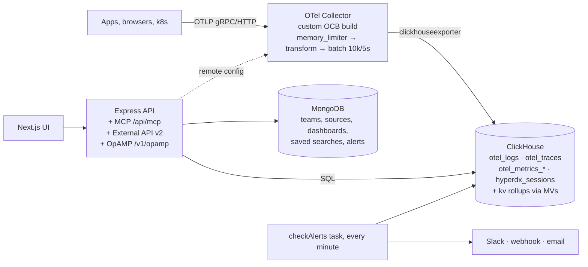

# ClickStack: the observability layer on ClickHouse

How ClickHouse's own observability product is built, read from its source and run locally. ClickStack is HyperDX
(acquired by ClickHouse) plus a custom OpenTelemetry Collector plus ClickHouse. It is the closest existing thing to
Clickland, so it is the reference design. Source: `upstream/clickstack-hyperdx` at `0096a355` (MIT), 14 November 2026.
Live evidence: `study/clickstack-live/probe.md` and `study/clickstack-ui/` (Craft Anything captures of every screen).

## Summary

ClickStack is a thin layer. Applications send OTLP to a collector, the collector batches and writes into four plain
MergeTree table families (`otel_logs`, `otel_traces`, `otel_metrics_*`, `hyperdx_sessions`), and an Express API plus a
Next.js UI turn Lucene-style searches and chart configs into SQL. MongoDB holds only metadata (teams, sources,
dashboards, saved searches, alerts). Everything hard (compression, indexing, aggregation, retention) is ClickHouse. The
product value is in four places: the **schema** (sort keys, codecs, text indexes, materialized attribute columns), the
**query compiler** (search language → SQL that hits those indexes), **pattern mining** (Drain) and **alerts**.

## 1. The schema (`docker/otel-collector/schema/seed/`)

### Logs: `00002_otel_logs.sql`

- `ORDER BY (toStartOfFiveMinutes(Timestamp), ServiceName, Timestamp)`, `PARTITION BY toDate(Timestamp)`,
  `TTL … ttl_only_drop_parts = 1`. The first key is a 5-minute bucket, not the raw timestamp, so rows of one service in
  one bucket sit together and a service filter still prunes inside a time range. Daily partitions make TTL a cheap
  whole-part drop.
- Codecs: `Timestamp DateTime64(9) CODEC(Delta, ZSTD(3))`; everything else `ZSTD(3)`; enum-like strings
  (`SeverityText`, `ServiceName`, schema URLs) are `LowCardinality(String)`.
- Attributes are `Map(LowCardinality(String), String)` for resource, scope and log attributes: one schema for any
  attributes, at the cost of reading the whole map column when one key is needed.
- Hot attribute keys are pulled out as `MATERIALIZED` columns named `__hdx_materialized_<key>` (k8s cluster, namespace,
  pod, container, deployment, node, `deployment.environment.name`, `session.id`). The query compiler rewrites
  `ResourceAttributes['k8s.pod.name']` to the materialized column.
- `*AttributeItems Array(String) ALIAS arrayMap(... concat(k, '=', v))` turns a map into `key=value` tokens at query time,
  so one text index answers `key:value` filters.
- Indexes are all the new **`text` index** (`TYPE text(tokenizer = 'array' | 'splitByNonAlpha')`): `TraceId`, session id,
  map keys, map `key=value` items, and `lower(Body)`. The index covers a whole part (`GRANULARITY 100000000`, seen in
  `EXPLAIN`), unlike the older per-granule bloom filters.
- `enable_block_number_column = 1, enable_block_offset_column = 1`: a stable row identity, used for "show the rows
  around this one".

### Traces: `00005_otel_traces.sql`

- `ORDER BY (ServiceName, SpanName, toDateTime(Timestamp))`: tuned for "latency of one endpoint over time", not for
  "fetch trace X". Trace lookup relies on the `text` index on `TraceId`.
- `Events.*` and `Links.*` are parallel arrays (a Nested shape). `Duration UInt64` (ns) has a `minmax` index for
  "slow spans" filters. `SampleRate` is materialized from the span attribute so counts can be re-weighted.

### Metrics: `00003_otel_metrics.sql`, `00008_otel_metrics_timeseries.sql`

- One table per OTel metric type (gauge, sum, histogram, exponential histogram, summary), all ordered
  `(ServiceName, MetricName, toStartOfHour(TimeUnix), cityHash64(Attributes), TimeUnix)`: the attribute-set hash is the
  series identity.
- An experimental `metrics_ts ENGINE = TimeSeries` table backs a PromQL source (`config.standalone.promql.yaml`,
  `common-utils/src/core/promql.ts`).

### Rollups: `00006_otel_logs_rollups.sql`, `00007_otel_traces_rollups.sql`

- A materialized view writes `(15-minute bucket, column, key, value, count)` into a `SummingMergeTree`. The filter
  sidebar ("ServiceName (1)", value counts) reads this small table instead of scanning logs. This is the pattern for every
  facet count in Clickland.

## 2. Ingestion (`packages/otel-collector`, `docker/otel-collector/config.yaml`)

- A custom collector built with the OpenTelemetry Collector Builder. Receivers: OTLP, filelog, hostmetrics, k8s cluster
  and kubelet stats, Prometheus, statsd, fluent-forward, docker stats, Datadog. Processors: memory_limiter, transform
  (OTTL), batch, filter, k8sattributes, logdedup, cumulativetodelta and more.
- Batching is tuned for ClickHouse: `send_batch_size 10000`, `timeout 5s` (config.yaml:171-185), because small inserts
  make many small parts. Live: 50 events/s for 20 s became **one part per table**.
- Exporters are not in the file: the API serves them over **OpAMP** (`packages/api/src/opamp/`), so the server owns the
  collector's ClickHouse credentials and table names.
- A `transform/session_id` step copies the browser session id into a common attribute, an example of normalising
  attributes at the edge instead of at query time.

## 3. The query compiler (`packages/common-utils/src`)

- `queryParser.ts` (2,314 lines): Lucene → AST (`@hyperdx/lucene`) → SQL through `CustomSchemaSQLSerializerV2`
  (line 1387). A bare term searches the source's `implicitColumnExpression` (usually `Body`); `field:value` resolves map
  keys, JSON paths and materialized columns.
- Text search prefers the text index: it emits `hasAllTokens(lower(Body), [...])` in batches of at most 64 tokens
  (lines 31, 1557-1610) when the index exists and `enable_full_text_index = 1`, falls back to `hasToken` when a bloom
  filter exists (line 1456), and to `ILIKE` otherwise. **The compiler reads the table's indexes
  (`buildTextIndexInfoLookup`, line 1344) and writes SQL that uses them.**
- `core/renderChartConfig.ts` (3,429 lines): a chart config (source, select, where, group by, granularity, time range)
  → SQL with `toStartOfInterval`, plus `core/materializedViews.ts` (1,014 lines), which swaps in a rollup table when
  one covers the query.
- `core/metadata.ts` (3,487 lines): reads `system.columns` / `DESCRIBE` / map keys to drive autocomplete and the
  filter sidebar. The UI is schema-agnostic: a **Source** (`api/src/models/source.ts`) maps any table to the roles
  `timestampValueExpression`, `implicitColumnExpression`, `traceIdExpression`, severity, service, and so on.

## 4. Analysis features

- **Event patterns** (`common-utils/src/drain/drain.ts`, 375 lines): a TypeScript port of the Drain log-template miner
  (depth 4, similarity 0.4). It runs on a sample of rows in the browser (`app/src/hooks/usePatterns.tsx`) and in the
  MCP tools (`runEventPatterns.ts`). "Denoise results" hides the most common templates.
- **Event deltas** (`core/eventDeltas.ts`): compares attribute value distributions between a selected set of rows and
  the rest ("what is different about the slow requests").
- **Service views** (`/services`, `/service-map`, `/kubernetes`, `/clickhouse`, `/llm`): preset dashboards over the
  same sources. The ClickHouse dashboard reads ClickHouse's own `system.*` tables.
- **Sessions**: browser session replay (rrweb events in `hyperdx_sessions`) joined to traces by `session.id`.

## 5. Alerts (`packages/api/src/tasks/checkAlerts/`)

- A cron task (every minute) loads alerts from MongoDB, renders each one's chart config to SQL for the window
  (`getAlertWindowStart`, `index.ts:466`), runs it, compares with `doesExceedThreshold` (`index.ts:327`; above, below,
  between, not between), keeps per-group history keyed `alertId||groupKey`, and sends through transports
  (`transports/slack.ts`, `generic.ts` webhooks). The task emits its own counters (`hyperdx.alerts.evaluations`,
  `query_failures`).
- There is no streaming evaluation: alerts are periodic SQL queries. That is cheap on ClickHouse and simple to reason
  about.

## 6. AI and APIs

- **MCP server** at `/api/mcp` (`packages/api/src/mcp/`), stateless Streamable HTTP, personal-key auth, 600 req/min.
  Tools: search, SQL, timeseries, table, PromQL, event patterns, pattern drill-down, event deltas, emerging signals,
  denoise, service health; dashboards (search/get/save/patch/query tiles); alerts and webhooks; saved searches.
  `packages/hdx-eval` benchmarks agents against synthetic incidents with these tools.
- **External API v2** (`routers/external-api/v2/`, OpenAPI in `packages/api/openapi.json`): alerts, charts,
  dashboards, sources, webhooks.

## 7. What Clickland should take

1. **Run ClickHouse; build the product above it.** ClickStack never reimplements storage. Its own work is the schema,
   the compiler and the workflows.
2. **Start from the ClickStack schema**, the version proven at scale: the 5-minute-bucket-first sort key for logs,
   `Delta+ZSTD` timestamps, `LowCardinality` enums, `Map` attributes with materialized hot keys, and `text` indexes on
   body, trace id and `key=value` items. Keep the `otel_*` names so the stock collector exporter and ClickStack's own
   UI can read our data on day one.
3. **Facet counts come from rollup tables**, filled by materialized views into `SummingMergeTree`, never from scanning
   raw logs.
4. **The search compiler must know the indexes** and emit `hasAllTokens` / materialized columns. This is the core piece
   of code Clickland writes.
5. **Alerts are periodic SQL**, and so are SLOs; no stream processor is needed.
6. **Metadata stays outside ClickHouse.** In the land family that is Landflow's Postgres and Landbright identities,
   not MongoDB.
7. **MCP first**: the same query tools for the UI, the agents and Landflow.

## Open questions

- ClickStack also ships `clickhouse/clickstack-all-in-one` with auth, which we did not run. Its collector can require
  an OIDC bearer token on the OTLP receiver (`docker/otel-collector/config.standalone.oidc.yaml`; this is for
  telemetry senders, not UI sign-in). Landbright could issue those tokens.
- The `text` index is new in ClickHouse 25.x/26.x. Its build cost on merge for high-volume bodies isn't measured here.
- HyperDX's licence is MIT; parts of the ClickStack Cloud offering (managed ingestion, Cloud UI) are not in this repo.
